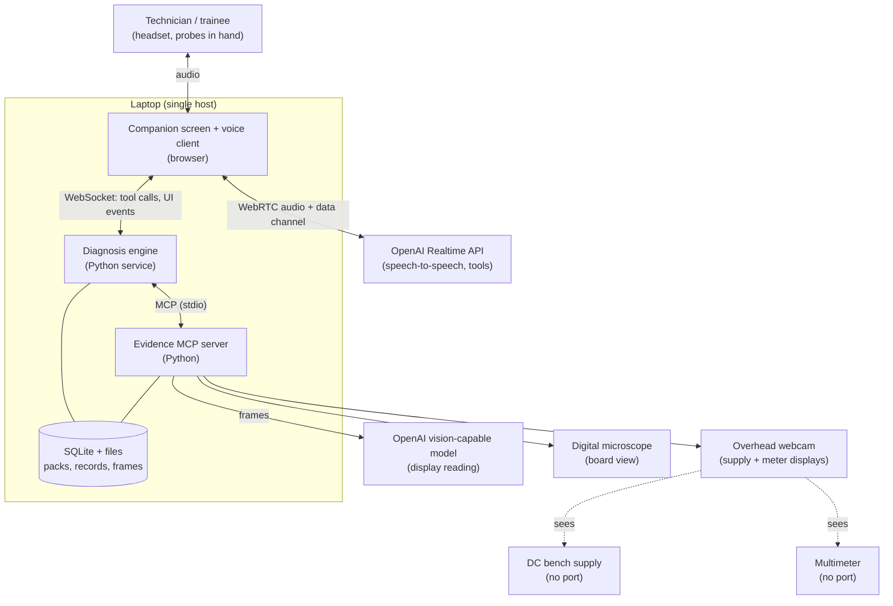
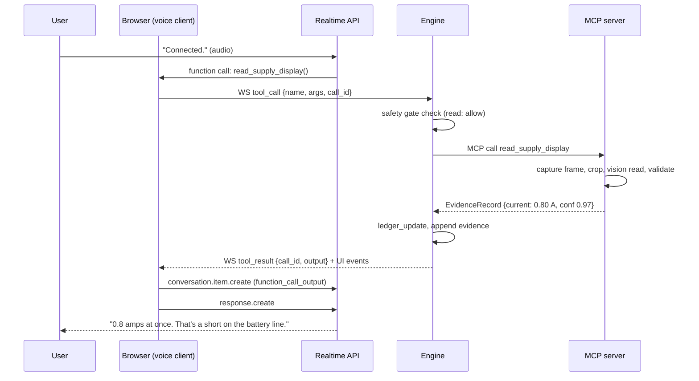
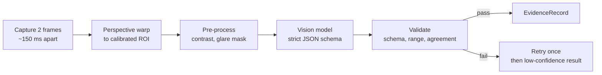
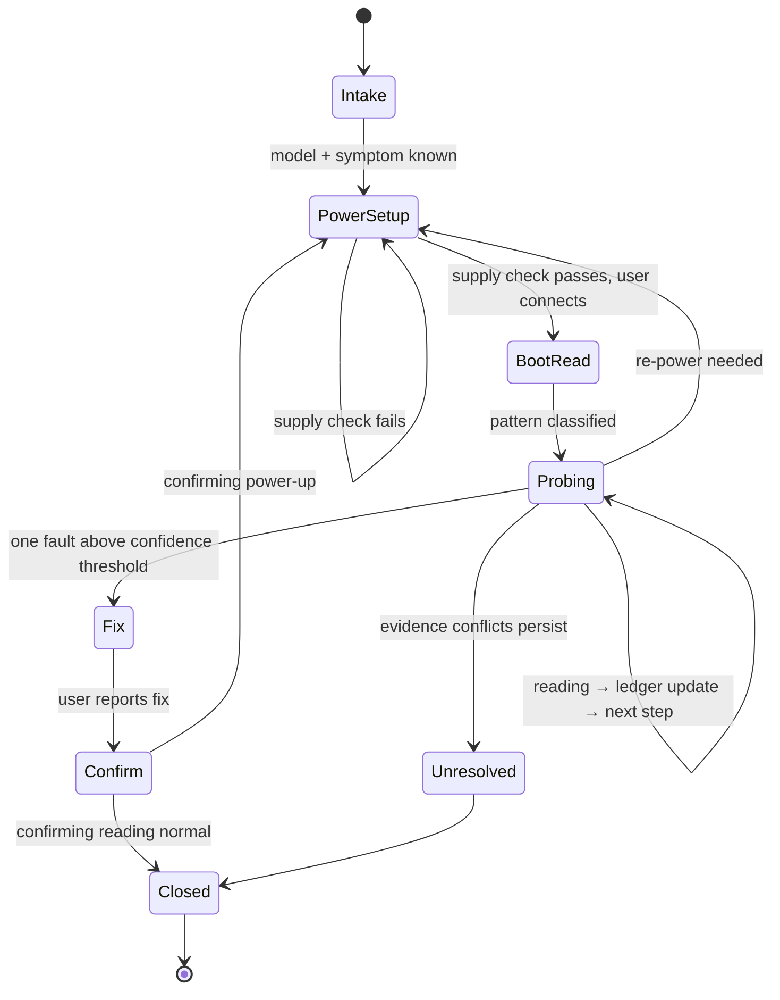

# Benchmate: Technical Architecture

**Voice-guided diagnosis for mobile phone board repair, Stage 1 (hackathon prototype)**

| | |
|---|---|
| Owner | Nikhil Pande |
| Scope | Stage 1 build, 3–28 Nov 2026; notes on Stage 2+ where design choices depend on them |
| Companion doc | `Benchmate_Product.md` |
| Last updated | 3 Nov 2026 |

> API names and event types for the OpenAI Realtime API below reflect the documented interface at the time of writing. Check them against the current docs in week 1 before building on them.

---

## 1. Goals and constraints

### 1.1 Goals
1. Real-time Hindi/English voice conversation with interruptions and tool calls.
2. Evidence from **shop instruments with no computer port**, read by camera, plus spoken readings.
3. A **deterministic, testable** diagnosis engine: the language model converses and explains; the ranking is computed in code.
4. **Code-enforced safety** on every power instruction.
5. Every claim traceable to a stored evidence record or a model-pack entry.

### 1.2 Constraints
| Constraint | Consequence for the design |
|---|---|
| Solo builder, 4 weeks | One laptop, one repo, few moving parts; no cloud backend beyond the model APIs |
| Cheap instruments, no ports | All instrument evidence is vision-read; reading confidence is first-class |
| Field test in a shop | Must run off a laptop on shop Wi-Fi or a phone hotspot; cameras and calibration must be quick to set up |
| Hindi speakers, noisy shops | Close-mic headset; push-to-talk fallback; trade vocabulary in prompts |
| Hackathon is OpenAI-supported | OpenAI Realtime API for voice; OpenAI vision-capable model for display reading |

### 1.3 Non-goals (Stage 1)
- Controlling any instrument or the board.
- Soldering or hot-air guidance.
- Multi-user, multi-bench or cloud sync.
- Customer data.

---

## 2. System context



**Trust boundaries**
- The speech model can only *propose* tool calls. The engine decides what runs.
- The safety gate sits inside the engine, in code, between proposed and executed calls.
- Instruments are never driven; the only physical actions are spoken instructions to a person, and power instructions are gated.

---

## 3. Components

| Component | Responsibility | Tech |
|---|---|---|
| Voice client | Mic capture, playback, WebRTC session to Realtime API, relays function calls to the engine, renders transcript | Browser (TypeScript), WebRTC |
| Companion screen | Board view, supply/meter readings, boot-current graph, ledger, evidence log, transcript, record export | Same web app (React or Svelte), WebSocket |
| Diagnosis engine | Session state, tool routing, safety gate, fault ledger, next-step scoring, prompt assembly, records | Python 3.11+, FastAPI (HTTP + WebSocket) |
| Evidence MCP server | Camera capture, display reading, boot-current watch, probe location, spoken-reading parse, pack lookup | Python, MCP Python SDK, OpenCV |
| Vision reader | Crops, sends display frames to the vision model with a strict JSON schema, validates results | Inside MCP server |
| Storage | Sessions, evidence, ledger snapshots, repair records; packs as JSON + photos; frames on disk | SQLite (via SQLModel/SQLAlchemy), filesystem |

**Why two Python processes (engine + MCP server)?** The MCP boundary keeps evidence tools reusable (Stage 3 phone-only mode, other agents) and testable in isolation. The engine is the single place where policy (safety, ledger) lives.

---

## 4. Voice layer

### 4.1 Session setup
1. Browser asks the engine for a short-lived Realtime client secret (the API key never reaches the browser).
2. Browser opens a WebRTC peer connection to the Realtime API: mic track up, model audio track down, plus a data channel for events.
3. Engine sends the session configuration via the browser (`session.update`): instructions, voice, tool list, turn detection, transcription.

### 4.2 Session configuration (sketch)
```json
{
  "type": "session.update",
  "session": {
    "model": "gpt-realtime-2.1",
    "instructions": "<system prompt: role, Hindi/English rules, safety rules, trade vocabulary>",
    "turn_detection": { "type": "semantic_vad" },
    "input_audio_transcription": { "model": "<transcription model>" },
    "tools": [ "<function definitions mirrored from the MCP tool list>" ],
    "tool_choice": "auto"
  }
}
```
- Use the **mini** model during development to save cost; switch to the flagship for evaluation and the demo.
- Turn detection: semantic VAD by default; fall back to server VAD with a higher threshold, or push-to-talk, in noisy shops.

### 4.3 Tool-call relay


### 4.4 Holding lines and long operations
- Any tool expected to take more than about 1 s returns an immediate `{"status":"started"}` result so the model can say "Reading the supply…", followed by an engine-pushed event when the result is ready.
- `watch_supply_current` runs in the background; the engine injects a short system message with the result, then triggers `response.create`.

### 4.5 Interruptions
- On `input_audio_buffer.speech_started` while the model is speaking: the browser stops playback, sends `response.cancel`, and truncates the unplayed audio from the conversation (`conversation.item.truncate`) so the model's memory matches what the user heard.
- "Stop / wait / ruko" intents also cancel running background reads via the engine (`cancel_operation(op_id)`).

### 4.6 Prompting
- **System prompt sections:** role and tone; language rules (reply in the user's language, trade terms in English); one-instruction rule; safety rules (never instruct power steps; call `request_power_step` instead); honesty rules (never state a value not in evidence; give confidence when below threshold).
- **Dynamic context** injected per turn by the engine: current model pack summary, top 3 ledger entries with probabilities, last 5 evidence records, user level (trainee/expert).
- The model **never computes the ranking**. It reads the ledger the engine provides.

---

## 5. Evidence MCP server

### 5.1 Tool contracts

All evidence tools return an `EvidenceRecord` (section 7.1). Errors return `{ "error": code, "message": ..., "retryable": bool }`.

| Tool | Input | Output | Notes |
|---|---|---|---|
| `read_supply_display` | `{}` | EvidenceRecord with `set_voltage`, `current_limit`, `live_current` fields | Two-frame agreement required |
| `watch_supply_current` | `{ duration_s ≤ 20, interval_s = 0.5, trigger?: "on_connect" \| "on_power_press" }` | `{ op_id }` then `BootCurrentTrace` | Background; cancellable |
| `read_meter_display` | `{ expected_mode?: "diode" \| "dcv" \| "ohm" }` | EvidenceRecord | Flags mode mismatch |
| `locate_probe` | `{ point_id }` | `{ on_point: bool, confidence }` | Best effort; microscope frame |
| `record_spoken_reading` | `{ text, point_id?, mode? }` | EvidenceRecord (source = spoken) | Parses Hindi/English numbers |
| `model_lookup` | `{ query }` | `{ model_id \| null, candidates[] }` | Fuzzy match on names/aliases |
| `pack_lookup` | `{ model_id, point_id }` | `PointSpec` | Normal value, tolerance, photo coords |
| `compare_to_reference` | `{ evidence_id }` | `{ status: "normal" \| "low" \| "high" \| "short" \| "open", margin }` | Uses PointSpec |
| `calibrate_displays` | `{ camera: "overhead", rois[] }` | `{ ok }` | Set once per setup from the screen UI |

Diagnosis tools (`ledger_update`, `next_step`, `close_diagnosis`, `session_recall`, `explain`) and safety tools (`check_power_setup`, `check_scope`) live **in the engine**, not the MCP server, because they hold policy and session state. They are exposed to the speech model as functions through the same relay.

### 5.2 Vision pipeline (display reading)



1. **Calibration (once per setup).** On the companion screen the user drags four corners around each display (supply voltage, supply current, meter). The engine stores a homography per ROI. Takes under a minute at a new bench.
2. **Capture.** Two frames about 150 ms apart (defeats flicker and mid-update digits).
3. **Warp and crop** each ROI to a flat, fixed-size image.
4. **Read** with an OpenAI vision-capable model using structured output:
```json
{
  "type": "object",
  "properties": {
    "legible": { "type": "boolean" },
    "value": { "type": ["number", "null"] },
    "unit": { "enum": ["V", "mV", "A", "mA", "ohm", "kohm", "diode_V", "OL", "unknown"] },
    "mode_indicator": { "type": ["string", "null"] },
    "decimals_shown": { "type": "integer" },
    "confidence": { "type": "number" }
  },
  "required": ["legible", "value", "unit", "decimals_shown", "confidence"]
}
```
5. **Validate**
   - Both frames agree within the last displayed digit, else retry once.
   - Value within the instrument's physical range and the expected mode.
   - Supply current never exceeds the current limit read in the same frame.
   - Confidence < 0.8 → returned with `needs_confirmation: true`; the agent asks to re-check or say the number.
6. **Optional cross-check (stretch).** A local seven-segment OCR (e.g. `ssocr`) on the same crop; disagreement lowers confidence. Also useful as an offline fallback.

**Latency target:** capture + warp ≈ 0.2 s, vision call ≈ 1–2 s, validation negligible → ≤ 3 s end to end.

### 5.3 Boot-current watch
- Samples the supply current ROI every 0.5 s for up to 20 s. To stay within the latency and cost budget, each sample uses a **cheaper path**: local OCR if calibrated and confident, otherwise the vision model on every second sample with interpolation flagged.
- Produces a `BootCurrentTrace`: samples, events (`connect`, `power_press` from the user's voice), and features:
  - `i_connect`: current within 1 s of connect, before power press.
  - `i_peak`: peak after power press.
  - `i_steady`: median of the last 5 s.
  - `t_drop`: time from peak to near zero, if any.
  - `at_limit_s`: seconds the current sat at the supply limit.
- **Classification** into pattern classes defined in the pack (or general flow): `NO_CURRENT`, `SHORT_IMMEDIATE`, `RISE_THEN_DROP`, `NORMAL_BOOT`, `AT_LIMIT`. Thresholds come from the model pack's reference trace, not hard-coded constants.

### 5.4 Probe location (best effort)
- The reference board photo has point coordinates. A one-time alignment maps the live microscope frame to the reference photo (feature matching, e.g. ORB + homography; re-aligned when the board moves).
- The probe tip is detected as the brightest metallic tip near the marked point, or by asking the vision model "is a probe tip touching the marked point?" on a crop.
- Output is advisory. If confidence is low the agent asks the user to say "ready".

### 5.5 Spoken readings
- Parser handles English and Hindi number words ("point zero zero two", "teen point do volt"), units and modes.
- Spoken evidence always gets `source = spoken`, confidence 0.7 by default, raised to 0.85 when read back and confirmed.

---

## 6. Diagnosis engine

### 6.1 Session state machine



### 6.2 Fault ledger

**Model.** For the chosen model the pack defines faults $F_1..F_n$ with prior weights $\pi_i$ (from pack frequency, uniform if unknown) plus a catch-all $F_{\text{other}}$ with a small prior. Each fault predicts an outcome class for each measurement $m$ (a boot pattern, or a point reading class such as `short`, `normal`, `high`, `open`).

**Likelihood of an evidence record** $e$ with confidence $c$ for fault $F_i$:

$$
P(e \mid F_i) = c \cdot \mathbb{1}[\text{class}(e) = \text{pred}_i(m)] + (1 - c)\cdot \frac{1}{K_m}
$$

where $K_m$ is the number of outcome classes for measurement $m$. If $F_i$ makes no prediction for $m$, use $1/K_m$. $F_{\text{other}}$ always uses $1/K_m$.

**Update.**

$$
P(F_i \mid e_{1..t}) \propto P(F_i \mid e_{1..t-1}) \cdot P(e_t \mid F_i)
$$

normalised across all faults. The ledger stores every snapshot with the evidence id that caused it, which drives the "what moved it" view on screen.

**Conflict detection.** If $P(F_{\text{other}})$ rises above 0.4, or the top fault's probability falls by more than 50% after a high-confidence reading, the engine flags a conflict. The agent then asks for a re-measure of the most influential earlier reading.

### 6.3 Next-best-step selection
For each candidate measurement $m$ available on this bench (pack-defined points, boot patterns), compute the expected information gain over the current posterior:

$$
\text{IG}(m) = H(F) - \sum_{o \in O_m} P(o)\, H(F \mid o), \quad P(o) = \sum_i P(F_i)\, P(o \mid F_i)
$$

Score $= \text{IG}(m) / \text{cost}(m)$, where cost reflects effort (re-powering = 3, diode check on an exposed point = 1, under a shield = 2). Ties are broken by pack order (the order an expert would follow). The engine returns the top step with a templated reason ("separates a shorted capacitor from a failed power chip"), which the model rephrases.

**Stop rule.** When the top fault exceeds 0.85 and the second is below 0.10, the engine moves to `Fix` and the agent proposes the fix with its evidence.

### 6.4 Why not let the LLM reason?
- **Repeatable:** the same evidence gives the same ranking; testable in CI.
- **Explainable:** every probability change links to one evidence record.
- **Safe:** the model cannot invent a confident diagnosis without evidence.
The LLM remains responsible for language, clarification, explanation and mentor mode.

### 6.5 Safety gate

| Check | Rule (code) | On fail |
|---|---|---|
| `check_power_setup` | Latest `read_supply_display` within 20 s; `set_voltage` within pack's safe band (default 3.8–4.2 V); `current_limit` set and ≤ pack max (default 2 A); both readings confidence ≥ 0.9 | Agent receives `blocked` with a specific reason, e.g. "limit not visible" |
| `check_scope` | Battery flagged disconnected by user confirmation; no "swollen/hot battery" flag; device class = phone board | Session paused with a safety message |
| `at_limit` watchdog | Supply current at its limit for > 3 s during any watch | Engine pushes an urgent "disconnect now" message |

The speech model never emits power instructions directly. It calls `request_power_step(step)`; the engine runs the checks and returns either the exact approved instruction text (`"Ab boot cable lagao."`) or a block reason. The approved text is what the model must say, which keeps the wording of risky steps fixed.

---

## 7. Data model

### 7.1 EvidenceRecord
```json
{
  "id": "ev_01J...",
  "session_id": "se_01J...",
  "kind": "meter",                 
  "point_id": "vbat_cap_1",
  "mode": "diode",
  "value": 0.002,
  "unit": "diode_V",
  "source": "camera",              
  "confidence": 0.96,
  "resolution": 0.001,
  "needs_confirmation": false,
  "frame_paths": ["frames/se_01J/ev_01J_a.jpg", "frames/se_01J/ev_01J_b.jpg"],
  "created_at": "2026-11-12T10:41:07+05:30"
}
```
`kind` ∈ `supply`, `meter`, `boot_trace`, `probe_check`, `spoken`. `source` ∈ `camera`, `spoken`.

### 7.2 Model pack (JSON)
```json
{
  "model_id": "redmi_x",
  "aliases": ["redmi x", "xiaomi x"],
  "safe_power": { "voltage_min": 3.8, "voltage_max": 4.2, "current_limit_max": 2.0 },
  "photos": { "top": "packs/redmi_x/top.jpg", "bottom": "packs/redmi_x/bottom.jpg" },
  "points": [
    {
      "id": "vbat_cap_1",
      "label": "Large capacitor beside battery connector",
      "side": "top",
      "xy": [412, 233],
      "mode": "diode",
      "probe_note": "Red on ground, black on capacitor",
      "reference": { "value": 0.35, "tolerance": 0.05, "unit": "diode_V" },
      "classes": { "short": [0, 0.05], "low": [0.05, 0.30], "normal": [0.30, 0.40], "high": [0.40, 1.5], "open": "OL" }
    }
  ],
  "boot_reference": { "i_connect": 0.0, "pattern": "NORMAL_BOOT", "trace_path": "packs/redmi_x/boot_ref.json" },
  "faults": [
    {
      "id": "vbat_short_cap",
      "name": "Shorted capacitor on battery line",
      "prior": 0.30,
      "predicts": { "boot_pattern": "SHORT_IMMEDIATE", "vbat_cap_1": "short" },
      "fix": "Locate and remove the shorted capacitor (technician)",
      "explain": { "trainee": "...", "expert": "..." }
    }
  ],
  "measurement_costs": { "boot_pattern": 3, "vbat_cap_1": 1 },
  "sources": ["reference board measured 2026-11-08", "field test 2026-11-18"]
}
```
All numbers above are **placeholders** for illustration. Real values come from the reference board.

### 7.3 Relational tables (SQLite)
| Table | Key columns |
|---|---|
| `sessions` | id, model_id, symptom, user_level, language, started_at, ended_at, state |
| `evidence` | id, session_id, kind, point_id, mode, value, unit, source, confidence, frame_paths, created_at |
| `ledger_snapshots` | id, session_id, evidence_id, probabilities_json, created_at |
| `steps` | id, session_id, measurement_id, reason, accepted, created_at |
| `repair_records` | id, session_id, root_cause_fault_id, fix_text, confirm_evidence_id, outcome, exported_pdf_path |
| `notes` | id, session_id, text, created_at |
| `calibrations` | id, camera, roi_name, homography_json, created_at |

---

## 8. Companion screen

- **Transport:** one WebSocket from the engine pushing typed events: `evidence.added`, `ledger.updated`, `step.proposed`, `power.blocked`, `power.approved`, `transcript.delta`, `session.state`.
- **Board view:** microscope stream via `getUserMedia` in the browser (the same device is also opened by the MCP server for frames; on Windows, share via a virtual camera or let the browser post frames to the engine to avoid device locks).
- **Boot-current graph:** rendered from `boot_trace` samples as they arrive.
- **Calibration UI:** four-corner drag per ROI; preview of the warped crop with a live reading.
- **Export:** repair record → HTML template → PDF (headless Chromium, already on the dev machine via Playwright).

---

## 9. Latency budget (target, per turn)

| Step | Budget |
|---|---|
| End of speech detected | 0.3–0.5 s |
| Model starts speaking (no tool) | ≤ 0.5 s after detection |
| Tool relay browser → engine → MCP | ≤ 50 ms |
| Frame capture + warp | ≤ 0.2 s |
| Vision read | 1.0–2.0 s |
| Validation + ledger update | ≤ 50 ms |
| Model speaks result | ≤ 0.5 s after tool output |
| **Spoken value after request** | **≤ 3.0 s** |

If the vision step exceeds 1 s, the holding line ("Reading the supply…") plays first, so the user never hears silence.

---

## 10. Repository layout

```
benchmate/
├── apps/
│   └── web/                  # voice client + companion screen (TypeScript)
│       ├── src/realtime/     # WebRTC session, event handling, barge-in
│       ├── src/screen/       # board view, ledger, evidence log, graph
│       └── src/calibrate/    # ROI calibration UI
├── engine/                   # FastAPI service
│   ├── api/                  # HTTP (client secret, export) + WebSocket
│   ├── session/              # state machine, prompt assembly
│   ├── ledger/               # Bayesian update, info gain, conflicts
│   ├── safety/               # power gate, scope checks, watchdog
│   ├── records/              # repair records, PDF export
│   └── tests/
├── mcp_evidence/             # MCP server
│   ├── cameras/              # capture, device management
│   ├── vision/               # warp, preprocess, VLM read, validation, OCR
│   ├── boot/                 # current watch, features, classification
│   ├── spoken/               # number parsing (hi/en)
│   ├── packs/                # pack loading and lookup
│   └── tests/
├── packs/
│   ├── general_dead_phone.json
│   └── <model_id>/           # pack.json, photos, boot_ref.json
├── eval/
│   ├── display_set/          # labelled photos of supply and meter
│   ├── boot_set/             # recorded traces with labels
│   ├── intent_set/           # recorded Hindi/English requests
│   ├── run_eval.py
│   └── REPORT-<date>.md
├── data/                     # SQLite db + frames (git-ignored)
├── CLAIMS.md                 # Proven / Stubbed / Assumed
└── README.md
```

---

## 11. Tech stack

| Layer | Choice | Why |
|---|---|---|
| Voice | OpenAI Realtime API over WebRTC (mini for dev, flagship for demo) | Native interruption, low latency, function calls; event sponsor |
| Vision | OpenAI vision-capable model with structured outputs; optional `ssocr` | Reads seven-segment and LCD displays; strict JSON |
| Engine | Python 3.11+, FastAPI, Pydantic, SQLModel | Fast to build; typed contracts shared with MCP |
| Evidence server | MCP Python SDK, OpenCV | Standard tool boundary; camera handling |
| Front end | TypeScript, React or Svelte, Vite | Builder's strongest area |
| Storage | SQLite + filesystem | Zero ops on a laptop |
| PDF export | HTML template + headless Chromium | Reuses the web stack |
| Remote demo | Cloudflare Tunnel | Free, no port forwarding |

---

## 12. Reliability and error handling

| Failure | Detection | Behaviour |
|---|---|---|
| Camera disconnected | Capture error | Agent: "The overhead camera isn't responding; say the reading instead." Spoken mode continues |
| Unreadable display (glare, flicker) | `legible=false` or frames disagree twice | Low-confidence record; agent asks to adjust light or say the number |
| Vision API slow or down | Timeout (4 s) | Fallback to local OCR if calibrated; otherwise spoken readings |
| Realtime session drops | WebRTC state change | Browser reconnects; engine re-sends session config and a summary of the session so far |
| Engine restart | Process supervisor | Session state rebuilt from SQLite; ledger recomputed from evidence |
| Conflicting evidence | Ledger conflict rule | Re-measure request; "unresolved" outcome if it persists |

Every tool has a timeout and one retry. Failures are spoken by name, never skipped silently.

---

## 13. Security and privacy

- **API keys** stay in the engine; the browser gets short-lived Realtime client secrets only.
- **Audio** streams to the Realtime API; not stored by default. Transcripts are stored with the session.
- **Frames** are cropped to the display or board before leaving the laptop.
- **No customer data in Stage 1**: only bought or scrap boards; field-test footage only with consent, board and hands only.
- **Model packs** contain only own measurements, photos and observed faults; no redistributed schematics.
- Local data folder is git-ignored; exported records contain no personal data by default.

---

## 14. Testing and evaluation

| Level | What | How |
|---|---|---|
| Unit | Ledger update, info gain, stop rule, conflict rule | pytest with synthetic packs; property tests (probabilities sum to 1, monotonic with confidence) |
| Unit | Safety gate | Table-driven tests: every combination of voltage, limit, confidence, staleness |
| Unit | Spoken number parser | Hindi/English/mixed phrases → values |
| Component | Display reader | `eval/display_set` (~200 labelled photos): accuracy, confidence calibration |
| Component | Boot classifier | `eval/boot_set` (~30 traces): pattern accuracy |
| Integration | Tool relay end to end | Scripted session with recorded audio replayed into the voice client |
| System | Own-board benchmark | 3 dead boards × 5 runs: correct fault, steps, time |
| System | Bad-evidence test | Injected wrong reading → conflict flagged, re-measure requested |
| System | Safety red-team | ~20 attempts to get a power instruction without a passing check |
| Field | Shop or student test | Protocol in the product doc; results into `eval/REPORT-<date>.md` |

`eval/run_eval.py` produces the report used in the README and the demo's closing card.

---

## 15. Deployment

**Stage 1 bench (home)**
- Laptop with both cameras on a powered USB hub; ring light; headset.
- `engine` and `mcp_evidence` run as two local processes (started by one script); web app served by the engine.
- Internet for the OpenAI APIs; phone hotspot as backup.

**Field kit (shop)**
- Laptop, headset, overhead camera + mount, ring light; microscope only if the shop has none.
- Setup checklist: position camera over the shop's supply and meter → calibrate ROIs (≤ 1 min) → test read of each display → start session.

**Replay mode**
- Any logged session can be replayed through the companion screen with recorded audio and frames, for demos when hardware or network fails.

---

## 16. Cost model (Stage 1)

| Item | Basis | Estimate |
|---|---|---|
| Realtime voice | About $0.05 per conversation minute (flagship) or $0.016 (mini), third-party estimate | ~25 hours dev and test → $25–75 |
| Vision reads | One call per display reading; boot watches reduced by local OCR | $15–40 |
| **Total API** | | **$40–115**, partly covered by the $50 hackathon credit |

Measure actual per-reading cost in week 1 and adjust the boot-watch sampling plan if needed.

---

## 17. Stage 2+ considerations (designed for, not built)

| Need | Design hook already in Stage 1 |
|---|---|
| Phone-only mode (phone camera, no laptop) | Evidence MCP server is a separate process with a stable tool contract |
| Bluetooth multimeters | New evidence tool returning the same `EvidenceRecord`, `source = instrument` |
| Pack authoring by technicians | Pack JSON schema is versioned; a form UI can write it |
| Fault frequencies from real repairs | `repair_records` link fault ids to outcomes |
| Multi-bench institutes | Session and records keyed by bench id; SQLite → Postgres migration path |
| Schematic-tool integration | Points carry stable ids that can map to component designators |

---

## 18. Open technical questions

- [ ] Vision accuracy on the chosen supply and meter under shop lighting (week 1 measurement).
- [ ] Can the boot-current watch rely on local OCR, or does it need the vision model each sample?
- [ ] Semantic VAD vs push-to-talk in a real shop's noise.
- [ ] Single microscope device shared between browser and MCP server on the dev OS.
- [ ] Probe-tip detection at phone scale: worth keeping, or rely on "ready" only?
- [ ] Exact current Realtime API event names and client-secret flow (verify in week 1).

---

## References
- OpenAI Realtime API pricing guide (Layer3 Labs): https://www.layer3labs.io/guides/openai-realtime-api-pricing
- Companion product document: `Benchmate_Product.md`
