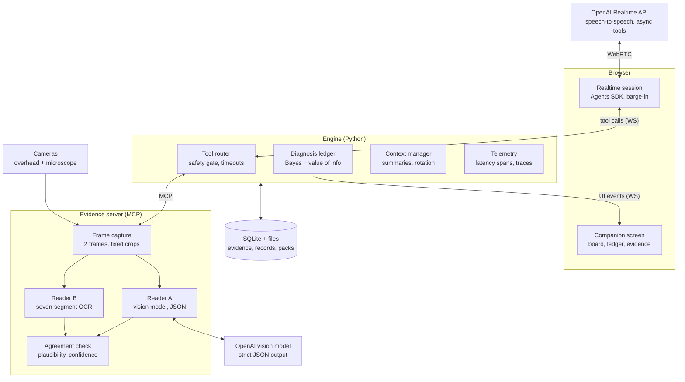

# Benchmate — Build Guide

Nov 3, 2026 · @Nikhil

## Decisions at a glance

Build Benchmate as a thin speech-to-speech conversation layer over a deterministic diagnosis engine, with every instrument reading taken by a dedicated, validated vision step. Each choice below follows a current published standard or a measured finding; the sections after this one hold the evidence.

| Area | Decision | Why (standard or finding) |
| --- | --- | --- |
| Voice transport | Browser ↔ OpenAI Realtime over WebRTC with short-lived client secrets | OpenAI and Microsoft both recommend WebRTC for browser clients: lowest latency, no server audio hop |
| Voice framework | OpenAI Agents SDK (TypeScript) `RealtimeSession` in the browser; tools run on our server | Gives interruption handling, guardrails and tracing out of the box; saves building them by hand |
| Model | Current flagship realtime model for the demo, mini for development; reasoning effort low | Higher reasoning effort adds latency; mini is about a third of the price |
| Turn detection | `semantic_vad`, eagerness medium; push-to-talk as the noisy-shop fallback | Practitioners report medium is the only setting that holds up in real calls |
| Tool surface | At most 8 coarse tools exposed to the voice model; all logic inside our engine | OpenAI-aligned guidance: treat the realtime model as a thin conversation model with 8–10 tools at most |
| Slow tools | Asynchronous function calling plus short spoken preambles | GA realtime keeps talking while a tool runs; preambles are the documented pattern |
| Instrument reading | A separate structured vision call per reading, cross-checked by a local seven-segment OCR; never trust a single frame | Frontier vision models read digital displays only about 80% correctly in a 2026 benchmark, so a single read is not good enough |
| Diagnosis | Decision-theoretic troubleshooting: Bayesian fault probabilities, next step chosen by value of information per unit cost | The established method for repair guidance (Heckerman and Breese, Microsoft Research) |
| Long sessions | `retention_ratio` truncation at 0.8, a token cap, engine-held summaries, session rotation | Latency drifts upward after 20+ turns; truncation settings keep the cache warm |
| Audio capture | Close-mic headset; `echoCancellation: true`, `autoGainControl: false`; no extra client denoiser | Prevents the agent hearing itself and interrupting its own speech |
| Hindi | Speech-to-speech model works on audio directly; numbers always read back and shown on screen | Hinglish recognition error rates are much higher than English, so safety-relevant numbers must be confirmed |
| Observability | Agents SDK tracing plus our own per-turn latency spans, reported as p50/p95 | Voice latency is judged at p95, not on average |
| Hackathon compliance | New code written in the event window, public GitHub repo, README with claims file | Matches HackIndia's published rules for its events |

## Voice agents today: what good looks like

The industry bar is a first spoken word within 800 ms of the user finishing, measured at p95, and stopping within about 200 ms when interrupted. Benchmate's tool-heavy turns will not hit 800 ms every time, so lag must be hidden, not just reduced.

**Latency norms**

- Production guides converge on under 800 ms voice-to-voice at p95, with under 500 ms as the goal for a natural feel ([Advantage Labs](https://advantagelabs.ai/blog/ai-voice-agent-latency-caller-hangups), [Prodinit](https://prodinit.com/blog/production-voice-ai-agents-latency-architecture)).
- Between 800 ms and 1.2 s people start repeating themselves or saying "hello?"; above 1.5 s experience degrades consistently.
- A practical tiering: under 1 s for simple answers, under 1.5 s for answers that need a lookup, under 200 ms for barge-in ([AI Agent Mindset](https://aiagentmindset.com/blog/voice-ai-accuracy-latency-benchmarks)).
- Measured on the OpenAI Realtime API: one team reported p50 1.1 s and p95 1.9 s with semantic VAD and low reasoning effort ([Techsy](https://techsy.io/en/blog/openai-realtime-api-voice-agent)). Treat 800 ms as the target for plain turns and 1.5 s for turns with a fast tool.
- **Tool calls are the latency cliff:** one round of tool calling roughly doubles perceived response time ([Sharvin Shah](https://www.sharvinshah.com/guides/voice-ai-agents)). Benchmate's camera reads (1–2 s) fall in this category, so they must be covered by spoken preambles.

**Turn detection**

- Pure silence-based VAD waits 500–800 ms after speech ends before anything happens; this is the single easiest place to lose half a second.
- Semantic turn detection uses meaning as well as silence, cutting the wait without interrupting people mid-thought.
- On OpenAI's `semantic_vad`, eagerness *low* feels laggy and *high* fires on natural pauses; *medium* is the setting practitioners keep ([Towards AI](https://pub.towardsai.net/i-built-a-voice-agent-on-openais-realtime-api-2da0977d4c51)).

**Barge-in**

- The agent must stop within about 200 ms of the user speaking and discard queued audio, or it talks over people.
- The common bug is "echo barge-in": the agent's own voice leaks into the mic and interrupts itself. Browser echo cancellation only works when playback goes through a WebRTC track or `<audio>` element, which acts as its reference signal ([DEV pitfall guide](https://dev.to/orca_forge/browser-voice-interaction-ai-pitfall-guide-2026-16-common-traps-with-aec-getusermedia-and-40hd)). A headset removes the problem almost entirely.
- Add a short cooldown after an interruption before detection can fire again.

**Long sessions**

- Turn latency on the Realtime API drifts from about 800 ms early in a session to over 2 s after 20+ turns because each turn re-sends prior context ([Fora Soft](https://forasoft.medium.com/openai-realtime-api-production-voice-agents-2026-9d4e861a6dcc)). A full board diagnosis can easily pass 20 turns, so context control is mandatory (see Latency engineering).

## Realtime API features to use

The GA Realtime API added several features that remove work we had planned to build by hand; use them, and keep our own engine for anything that must be deterministic.

| Feature | What it does | How Benchmate uses it |
| --- | --- | --- |
| WebRTC transport | Browser connects straight to OpenAI; \~100 ms transport latency in Microsoft's docs ([Microsoft Learn](https://learn.microsoft.com/en-us/azure/foundry/openai/how-to/realtime-audio)) | Voice path; the server never relays audio |
| `semantic_vad` with eagerness | Turn detection based on meaning as well as silence ([Agents SDK docs](https://openai.github.io/openai-agents-js/guides/voice-agents/build/)) | Default turn detection, eagerness medium |
| `interruptResponse` / `createResponse` flags | Control whether user speech cancels the current answer and whether the model replies automatically | Interrupt on; auto-response on, except during a pending power confirmation |
| Asynchronous function calling | The model keeps a fluid conversation while a function call is pending ([OpenAI](https://openai.com/index/introducing-gpt-realtime/)) | Camera reads and boot-current watches run without dead air |
| Preambles | Short spoken updates while the model works or calls a tool ([OpenAI prompting guide](https://developers.openai.com/api/docs/guides/realtime-models-prompting.md)) | Fixed Hindi/English preamble phrases per tool ("Reading the supply…", "Supply padh raha hoon…") |
| Image input | Images can be added to a session alongside audio | Optional: send the board photo once for context. **Not** used for numeric readings (see next section) |
| Remote MCP servers | A session can call a remote MCP server's tools directly | Not used in Stage 1: our tools run locally behind the safety gate. Keep the evidence server MCP-compatible so this becomes an option later |
| Truncation with `retention_ratio` | Drops a larger slice of old context at once so the prompt cache stays warm ([OpenAI cost guide](https://developers.openai.com/api/docs/guides/realtime-costs)) | `retention_ratio: 0.8` plus a `post_instructions` token cap |
| Mini models | Same API, much lower price | Development and automated tests |
| Reasoning effort | Reasoning-capable realtime models accept an effort setting; higher costs latency | `low` |
| 60-minute sessions | Sessions can last up to 60 minutes ([OpenAI developer notes](https://developers.openai.com/blog/realtime-api)) | Rotate before that, with a summary carried over |

**Prompting rules from OpenAI's realtime guide** ([cookbook](https://developers.openai.com/cookbook/examples/realtime_prompting_guide))

- Use short labelled sections: Role and Objective, Personality and Tone, Language, Preambles, Verbosity, Tools, Unclear Audio, Safety.
- The model follows sample phrases closely, so give exact Hindi and English example lines for each situation.
- Be precise; conflicting instructions degrade behaviour. One wording change can shift behaviour, so iterate with recordings.
- Add an explicit "unclear audio" rule: ask for a repeat in the user's language rather than guessing.
- Pin the language rules (reply in the language spoken to, keep trade terms in English).

**Model choice.** OpenAI's line-up is moving fast: the docs describe a reasoning `gpt-realtime-2`, the Agents SDK examples use `gpt-realtime-2.1`, and one comparison lists a separate GPT-Live model with lower turn latency ([Fora Soft](https://www.forasoft.com/blog/article/openai-realtime-api-voice-agent-production-guide-2026)). Pick the current flagship and mini on day 1, run the latency script from the testing section on both, and fix the choice before building prompts around it.

## Reading instrument displays with vision

A single vision-model read of a meter is not reliable enough to diagnose from. Benchmate reads every display twice, by two different methods, and only trusts a value when they agree.

**What the research shows**

- In MeasureBench (CVPR 2026, 2,442 images of measuring instruments), frontier vision models read **digital** displays about 80% correctly and dials about 31%. Extra reasoning did not help, and smaller models matched larger ones because the limit is the vision encoder ([paper notes](https://en.papernotes.org/CVPR2026/multimodal_vlm/do_vision-language_models_measure_up_benchmarking_visual_measurement_reading_wit/)).
- Unit recognition is easy (above 90%); **the value, especially the decimal point, is where reads fail**. Decimal errors are the dangerous ones here (0.35 vs 3.5).
- Purpose-built seven-segment OCR does well with modest data: a YOLOv8 + CRNN pipeline reached about 96% on real-world photos after \~300 labelled images, and fixing the crop alone added about 8 points ([lcd-digit-recognition](https://github.com/OICWS/lcd-digit-recognition)).
- Older academic pipelines report 88–93% on meter LCDs; glare, LED bleed and nearby printed text are the usual causes of failure ([ITM Conferences](https://www.itm-conferences.org/articles/itmconf/pdf/2024/06/itmconf_amict2023_01007.pdf)).

**What Benchmate does about it**

1. **Control the scene first.** A fixed overhead mount, a diffused ring light angled to avoid glare, and a one-time four-corner calibration so every crop is the display and nothing else. This is the cheapest accuracy gain available.
2. **Two independent readers.** (a) A vision-model call with a strict JSON schema that returns digits, decimal position, unit, mode indicator and a legibility flag; (b) a local seven-segment OCR on the same crop (start with `ssocr`; train a small CRNN on your own \~300 photos if accuracy is short).
3. **Two frames, about 150 ms apart.** The display must be stable across both frames; this defeats flicker and digits caught mid-update.
4. **Agreement rule.** Accept only when both readers agree on the digits and the decimal point. If they disagree, take a third frame; if they still disagree, return the value as low confidence and the agent asks the person to read it aloud.
5. **Plausibility rules.** The supply current cannot exceed the current limit shown on the same display; diode-mode values must fall in the meter's range; the mode on screen must match the mode the agent asked for.
6. **Ask about decimals, not digits.** When a value sits near a decision threshold (for example 0.03 vs 0.3), the agent reads it back and asks for confirmation before acting.
7. **Measure on your own equipment.** Stand-in images only prove the pipeline works. Accuracy numbers come from photos of the actual supply and meter, and again on the shop's equipment during the field test.

**Why not read the meter inside the voice session?** Realtime image input exists, but a numeric reading needs a structured, validated, logged value with a confidence and a frame on disk. A separate call gives that and keeps reading errors out of the conversation history.

## Diagnosis reasoning: the established method

Guided repair has a well-studied method: **decision-theoretic troubleshooting**. Benchmate follows it rather than letting the language model improvise a diagnosis.

- The method keeps a probability for each possible fault, updates it with every observation (Bayes' rule), and chooses the next action by comparing the **expected cost of repair** with and without each possible observation ([Breese and Heckerman, Microsoft Research](https://arxiv.org/pdf/1302.3563)).
- With independent faults, the cheapest repair order sorts parts by probability divided by the cost of checking them. Observations are worth taking only when they lower the expected cost of the remaining repair ([Heckerman, Breese and Rommelse](https://microsoft.com/en-us/research/wp-content/uploads/1994/01/Troubleshooting-Under-Uncertainty.pdf)).
- Their deployed system records each resolved case and updates its probabilities, so recommendations adapt to the real population of faults ([Microsoft Research](https://www.microsoft.com/en-us/research/?p=151283)), which is exactly Benchmate's feedback loop for model packs.

**How Benchmate applies it**

- **Faults:** the model pack's known faults plus an "other" catch-all; priors from pack frequency.
- **Observations:** boot-current pattern, diode readings at marked points, rail voltages. Each fault predicts an outcome class for each observation.
- **Update:** Bayes' rule with likelihoods softened by reading confidence, so a doubtful camera read moves probabilities less.
- **Next step:** for each available measurement, estimate how much it lowers the expected cost of finishing the repair (value of information), divided by its effort cost (re-powering is costly, a diode check on an exposed point is cheap). Pick the best; break ties with the expert order written in the pack.
- **Stop:** when one fault passes 0.85 and the next is below 0.10, propose the fix.
- **Conflict:** if "other" rises above 0.4, or a high-confidence reading knocks the leader down sharply, ask to re-measure the most influential earlier reading.
- **The language model never ranks faults.** It explains, asks, and phrases the next step that the engine computed. That keeps the diagnosis repeatable, testable and explainable.

## Hindi and Hinglish speech

Hindi-English mixing is the normal way Benchmate's users talk, and it is where speech recognition is weakest; design so a misheard word can never become a wrong action.

**What the research shows**

- Code-switched speech raises word error rates by 30–50% relative to single-language speech; Hinglish typically sits at 15–22% WER in good conditions and worse in production ([Awaaz](https://www.awaaz.ai/blog/automatic-speech-recognition-asr-india-guide)).
- India-focused vendors argue that global models post 22–34% WER on Indian speech ([Caller Digital](https://www.caller.digital/blog/voice-ai-india-vs-global-platforms)); treat that as a vendor claim, but plan for errors.
- OpenAI quotes a customer reporting 12.5% lower WER on Hindi, Tamil and Telugu with its realtime translation model than with others tested ([OpenAI](https://openai.com/index/advancing-voice-intelligence-with-new-models-in-the-api/)).
- India-specific recognisers such as Sarvam's Saaras V3 are built for code-mixed speech ([Sarvam](https://www.sarvam.ai/blogs/asr)); they are an option for Stage 2, not needed for the hackathon.

**What Benchmate does about it**

- **Speech-to-speech, not transcript-first.** The realtime model reasons on audio, so the conversation does not depend on a perfect transcript. Transcripts are for the screen and the log.
- **Numbers are never trusted from speech alone.** A spoken reading is read back and shown on screen; it gets lower confidence in the ledger.
- **Small, fixed vocabulary.** The prompt lists the trade words in both scripts (short, diode mode, boot current, VBAT, current limit, "ruko", "aage", "wapas") with example sentences, because the model copies sample phrases closely.
- **Unclear-audio rule.** "If audio is unclear, ask for a repeat in the user's language; never guess a number."
- **Power steps use fixed wording.** The safety gate returns the exact sentence to speak, so mishearing cannot change what a risky instruction says.
- **Test with your own voice and a shop's noise.** The 60-request spoken test set includes Hindi, English, mixed speech, and the same requests recorded with background shop noise.

## Hackathon rules and what is allowed

AgentVerse '26 has not published detailed rules beyond the problem statements, so follow HackIndia's standing rules and check the event dashboard before submission.

- **Problem statement fit.** PS-03 asks for a real-time voice agent that uses tools and APIs to solve a real problem with voice as the primary interface; Benchmate fits directly.
- **What judges see.** HackIndia says AgentVerse teams "are evaluated on what they ship, not what they pitch" ([HackIndia](https://hackindia.org/news/openai-supports-hackindia-agentverse-2026)). Prioritise a working live demo over slides.
- **Original work in the event window.** HackIndia's published rules for its events require original work built during the hackathon, a **public GitHub repository** with a README, and treat plagiarism as grounds for disqualification ([C# Corner, HackIndia rules](https://www.c-sharpcorner.com/article/hackindia-2026-pre-hackathon-build-the-future-with-web3-ai)). Start the repo fresh after 30 Oct; do not paste in code from earlier projects.
- **Libraries and APIs.** HackIndia campus events allow existing libraries and APIs as long as the core functionality is new. OpenAI APIs are the event sponsor's, so they are the safest choice; open-source OCR (`ssocr`, OpenCV) and the Agents SDK are ordinary libraries.
- **Team size.** Some HackIndia events require 2–4 members and bar individuals. **Confirm** your team registration is valid for AgentVerse '26 before investing more time.
- **Credits.** Eligible teams receive $50 of OpenAI API credits; budget for spend above that.
- **IP.** HackIndia's rules let it showcase submissions; you keep ownership. Do not commit anything you would not want public (API keys, partner shop footage without consent).

## Reference architecture (revised)

Three local processes on one laptop: the browser holds the voice session and the screen, the engine holds every decision, and the evidence server holds every reading. Audio never passes through our code; every tool call does.

The tool router is the only door from the voice model to the bench: it applies timeouts and the safety gate before anything runs. Readers A and B work on the same pair of cropped frames; the agreement check decides what becomes evidence.

**Changes from the earlier architecture document**

- The voice client uses the **Agents SDK** `RealtimeSession` instead of hand-written WebRTC event handling.
- Tools exposed to the voice model shrink from 15 fine-grained tools to **8 coarse ones**; the fine-grained tools stay inside the engine and evidence server.

| Exposed tool | What it covers inside |
| --- | --- |
| `start_repair(model, symptom)` | model lookup, pack load, priors |
| `get_reading(kind)` | supply or meter read with both readers and the agreement check |
| `watch_boot_current(trigger)` | background current watch and pattern classification (async) |
| `record_spoken_reading(text)` | spoken number parsing, read-back |
| `next_step()` | ledger update, value-of-information choice, reason text |
| `request_power_step(step)` | supply check, scope check, approved wording |
| `explain(topic, level)` | mentor-mode explanation from the pack |
| `close_repair(result)` | confirming reading, repair record, recall index |

- A **second reader** (local seven-segment OCR) and an **agreement check** are added to the evidence server.
- A **context manager** is added to the engine to keep sessions short and fast (next section).
- **Telemetry** records a span for every stage of every turn, so latency is measured, not guessed.

## Latency engineering

There are three kinds of turn, each with its own target. Hide what cannot be cut: the user should hear a word within about a second on every turn, even when the reading behind it takes three.

| Turn type | Example | First spoken word | Answer with the value |
| --- | --- | --- | --- |
| Plain | "Why that capacitor?" | ≤ 0.8 s (p95 ≤ 1.2 s) | same |
| Reading | "Read the meter." | ≤ 1.0 s (a preamble) | ≤ 3.0 s |
| Watch | "Watch the current while I press power." | ≤ 1.0 s (a preamble) | event-driven, within 1 s of the pattern being classified |

**Budget for a reading turn (target)**

| Stage | Budget |
| --- | --- |
| End-of-turn detection (`semantic_vad`, medium) | 0.3–0.5 s |
| Model emits tool call + preamble starts | ≤ 0.5 s |
| Browser → engine → evidence server | ≤ 50 ms |
| Frames ready (already in the ring buffer) | ≈ 0 ms |
| Readers A and B in parallel | 1.0–2.0 s (A); ≤ 100 ms (B) |
| Agreement, ledger, result back | ≤ 50 ms |
| Model speaks the value | ≤ 0.5 s |

**Techniques, in order of payoff**

1. **Preambles + async tools.** Fixed short phrases ("Reading the meter…" / "Meter padh raha hoon…") play while the tool runs. This removes the dead air that causes users to repeat themselves.
2. **Always-on frame ring buffer.** The evidence server keeps both cameras open and holds the last 2 seconds of frames. A reading never waits for a camera to open or focus.
3. **Local OCR runs continuously; the vision model confirms.** Reader B reads the display several times a second and detects when the value is stable. When a reading is requested, the stable value is already known; Reader A runs once to confirm. Change detection (pixel difference on the crop) skips work when nothing changed.
4. **Parallel readers.** A and B run at the same time on the same frames, never one after the other.
5. **Small images.** Send only the tight display crop, resized to the smallest size that keeps digits sharp (start around 512 px wide). Fewer image tokens means a faster, cheaper call.
6. **Cache by image.** Hash each crop; an identical crop returns the cached read instantly.
7. **Hedged request on slow reads.** If Reader A has not answered in 2.5 s, send a second request and take whichever returns first; cancel the other. Hard timeout at 4 s, then fall back to Reader B (if confident) or ask the person to read it aloud.
8. **Speculative reads.** When the agent says "Connect the boot cable", start the current watch immediately; when the person says "ready", the meter read has already started.
9. **Keep tool outputs tiny.** Return one short JSON line to the voice model (`{"value":0.35,"unit":"V","status":"normal","conf":0.97}`), never logs or frames. Every token in context costs latency on every later turn.
10. **Stable instructions and tools.** Never change the instructions or tool list mid-session; OpenAI notes this reduces the cache rate for later turns. Put changing state in short engine-injected messages instead.
11. **Context control.** `truncation: {type: retention_ratio, retention_ratio: 0.8, token_limits: {post_instructions: 8000}}`. The engine keeps the real state (ledger, evidence) and injects a compact summary every few turns, so dropping old audio loses nothing important.
12. **Session rotation.** Start a fresh session after about 25 turns or 30 minutes, at a natural pause (after a reading), seeded with the engine's summary. The user hears nothing; latency resets.
13. **Connect early.** Request mic permission and open the WebRTC session when the page loads, not when the user first speaks.
14. **Low reasoning effort** on the realtime model; all heavy reasoning is already done by the engine.
15. **Non-blocking engine.** One asyncio event loop; camera capture and OCR on worker threads; no synchronous network calls in request handlers.

**Network from Pune.** Requests travel to OpenAI's servers abroad, and shop Wi-Fi or a phone hotspot adds jitter. Measure round-trip times from your own connection and from the shop on day 1 of the field test; keep a wired or strong hotspot connection for the demo. WebRTC copes with jitter better than WebSocket, which is another reason to use it.

## Corner cases

Every case below has a detection rule in code and a defined behaviour; none is left to the model's judgement alone. Each becomes a test in the evaluation set.

**Voice and audio**

| Case | Detection | Behaviour |
| --- | --- | --- |
| Agent hears itself and interrupts itself | Interruption within 300 ms of its own speech start with no user speech on the transcript | Headset by default; echo cancellation on; 250 ms cooldown after each interruption |
| User coughs, tools clatter, a customer talks nearby | Very short or empty transcript after a turn | Ignore turns under a minimum length; reply only if speech was intelligible; push-to-talk switch for loud shops |
| User trails off mid-sentence ("capacitor ke paas wala…") | Semantic VAD waits; no completion after a timeout | Prompt asks a short clarifying question instead of guessing |
| User interrupts during a power instruction | Barge-in while a power step is pending | The pending power step is cancelled; it must be re-requested and re-checked |
| Misheard number ("point three five" heard as "three five") | Value outside the plausible range for that point and mode | Read back, show on screen, ask to confirm; never act on it unconfirmed |
| Language switch mid-session | Language tag on the transcript changes | Reply in the new language; keep trade terms in English |
| Long silence while the user works | No speech for 60 s | Stay silent; do not prompt. After 5 minutes, one gentle check-in |
| User asks something off-topic | Intent outside repair scope | One-line answer or polite redirect; no tool calls |

**Network and API**

| Case | Detection | Behaviour |
| --- | --- | --- |
| WebRTC connection drops | Peer connection state `disconnected`/`failed` | Auto-reconnect with backoff; new session seeded with the engine summary; agent says "I'm back" |
| Realtime API error or rate limit | Error event | Retry once; then switch to the mini model; then text-only mode on screen |
| Vision call slow | No response after 2.5 s | Hedged second request; hard timeout at 4 s |
| Vision API down | Repeated errors | Reader B alone if confident; otherwise spoken readings; screen shows "Camera reading limited" |
| Credits run out | Billing error | Stop new sessions; show a clear message; keep records accessible |
| Hotspot jitter | Rising turn latency in telemetry | Warn on screen; push-to-talk reduces false turns on bad links |

**Vision and readings**

| Case | Detection | Behaviour |
| --- | --- | --- |
| Glare on the display | Readers disagree or legibility flag false | Ask to tilt the light; retry; else spoken reading |
| Display flickering or mid-update | Two frames differ | Wait for two stable frames before reading |
| Decimal point misread | A and B disagree on decimal position, or value near a decision threshold | Treat as low confidence; read back and confirm |
| Meter on the wrong mode | Mode indicator does not match the requested mode | "Your meter is on volts; switch to diode mode" before reading |
| Meter shows OL (open) | Reader returns `OL` | Valid evidence: "open" class, not an error |
| Auto-ranging meter changes units (mV / V) | Unit differs from last read | Normalise units before comparing |
| Camera moved or bumped | Crop no longer matches calibration (feature check) | Ask for recalibration; pause camera reads |
| Supply current above its own limit | Plausibility rule | Re-read; if it persists, flag a reader error |
| Low battery on the multimeter (blank or dim LCD) | Legibility false repeatedly | Ask the user to check the meter battery |
| Hand or probe blocking the display | Large change across the whole crop | Wait, then ask to clear the view |

**Diagnosis and evidence**

| Case | Detection | Behaviour |
| --- | --- | --- |
| No model pack for the phone | `model_lookup` returns none | Use the general dead-phone flow; say so out loud |
| Two faults at once | Two faults stay high after several readings | Report both; suggest fixing the cheaper one first and re-checking |
| Evidence contradicts every known fault | "Other" above 0.4 | Re-measure the most influential reading; then "unresolved" with a full record |
| User skips a step or measures the wrong point | Probe check fails, or the reading fits a different point | Ask which point they measured; relabel or discard |
| User reports a fix but nothing changed | Confirming reading still abnormal | Back to probing with the new evidence; the fix is recorded as tried |
| Reference value missing for a point | Pack lookup has no reference | Use the general expected range; lower confidence |
| Board not the model the user named | Readings fit no known pattern for that model | Ask to confirm the model; offer the general flow |

**Safety**

| Case | Detection | Behaviour |
| --- | --- | --- |
| Supply set above the safe voltage | Supply read outside the pack's band | Block the power step; say the exact value to set |
| Current limit not visible or not set | Limit field missing or low confidence | Block until it reads clearly |
| Board sits at the current limit | Watch shows the limit for more than 3 s | Urgent "disconnect now" |
| Battery mentioned as connected, swollen or hot | Keyword or user answer | Stop the session with a safety message |
| User asks about a charger, TV or anything on mains | Device class outside scope | Refuse guidance and explain why |
| Stale supply reading (over 20 s old) at power step | Timestamp check | Re-read before approving |

**Session and state**

| Case | Detection | Behaviour |
| --- | --- | --- |
| Engine crashes mid-session | Process supervisor | Restart; rebuild state from SQLite; the voice session resumes with a summary |
| Browser tab reloads | New page load with an open session id | Offer to resume the last session |
| Session nears its time or token limit | Turn count, duration, token usage | Rotate at the next pause |
| Two people talking (technician and trainee) | Overlapping speech | Address whoever asked last; screen keeps the shared state |

## Reliability, observability and testing

Measure every turn from day 1. Latency and accuracy regress quietly with each prompt change, so every change re-runs the same automated checks.

**What every turn records (telemetry spans)**

- `speech_end` → `first_audio` (the number users feel)
- `tool_call_emitted`, `tool_started`, `tool_finished` per tool, with the tool name
- `reader_a_ms`, `reader_b_ms`, `agreement` (yes/no), `hedged` (yes/no)
- `ledger_top`, `ledger_top_p`, `conflict` flag
- `turn_index`, `session_tokens`, `rotated` flag
- Agents SDK traces for tool calls and guardrails, linked by session id

Report p50 and p95 per turn type. A dashboard tab on the companion screen (hidden in demo mode) shows them live.

**Test layers**

| Layer | What | How |
| --- | --- | --- |
| Unit | Ledger update, value-of-information choice, stop and conflict rules | pytest with synthetic packs; property tests (probabilities sum to 1, more confident evidence moves probability more) |
| Unit | Safety gate | Table-driven: every mix of voltage, limit, confidence, staleness |
| Unit | Spoken number parser | Hindi, English and mixed phrases → values |
| Component | Display readers A and B | \~200 labelled photos of your supply and meter; accuracy, decimal errors, confidence calibration |
| Component | Boot classifier | \~30 recorded traces |
| End to end | Full voice sessions with recorded speech | Playwright drives Chrome with its fake-audio flags (`--use-fake-device-for-media-stream`, `--use-file-for-fake-audio-capture`) to replay recorded requests; the fake bench supplies scripted readings |
| Fault injection | Camera unplugged, vision timeout, network throttled, engine restart | Toggles in the fake bench and Chrome network throttling |
| Safety red-team | \~20 attempts to get a power instruction without a passing check | Scripted and spoken |
| Field | Shop or student test | Protocol in the product document |

**Fake bench.** A mock evidence server with scripted scenarios (short on battery line, no current, not charging, glare, conflicting reading). It lets the whole system run and be tested before any hardware arrives, and later doubles as replay mode. Keep its numbers rough until real reference readings replace them, so the engine is not tuned to invented values.

**Regression rule.** Any change to the prompt, tools, model or VAD settings re-runs the end-to-end set and compares p95 latency and intent accuracy with the last run. Results go into `eval/REPORT-<date>.md`.

**Graceful degradation ladder** (each step keeps the session alive)

1. Full: camera readings with both readers
2. Reader B only (vision API slow or down)
3. Spoken readings only (cameras unavailable)
4. Mini voice model (flagship errors or rate limits)
5. Text on screen only (voice unavailable)

## Security, privacy and safety

The main risks are a leaked API key, an unsafe power instruction and unconsented footage; each has a specific control.

- **Keys.** The OpenAI API key lives only in the engine's environment. The browser gets short-lived client secrets from an engine endpoint. `.env` is git-ignored; a pre-commit secret scan runs before every push to the public repo.
- **Local-only by default.** The engine and evidence server bind to `127.0.0.1`. Remote demo access goes through a Cloudflare Tunnel with access protection, opened only for judging.
- **Tool input validation.** Every tool argument is validated with Pydantic; unknown fields are rejected; the safety gate runs before execution, never after.
- **Prompt-injection surface is small.** Benchmate reads no web pages, emails or documents, so there is little untrusted text. Model-pack text is written by you and loaded as data, not as instructions.
- **Safety rules live in code.** Power steps use engine-approved wording; out-of-scope devices are refused by the engine; the model cannot override either.
- **Audio and frames.** Audio is not stored by default; frames are cropped to the display or board before sending; frames stay on the laptop.
- **People.** No customer phones in Stage 1. Field footage only with written or recorded consent, board and hands only. Personal data in records is minimal; under India's Digital Personal Data Protection Act, keep consent and a deletion route if any is stored.
- **Repository hygiene.** Public repo contains code, packs with your own measurements, the evaluation reports and the claims file; no keys, no partner footage, no schematics.

## Build order

Build the measured skeleton first, then the parts that need no hardware, then the camera work as soon as the supply and meter arrive. The 10 Nov gate is judged on real displays.

**3–4 Nov: skeleton and measurement**

- [ ] Fresh public repo (after 30 Oct, per the originality rule); `.env` ignored; secret scan hook
- [ ] Engine (FastAPI) with the client-secret endpoint and a WebSocket
- [ ] Browser `RealtimeSession` (Agents SDK) connected over WebRTC; one dummy tool round trip
- [ ] Telemetry spans and the latency log from the very first turn
- [ ] Latency script: 20 scripted turns on the flagship and mini models; pick the model
- [ ] Order the multimeter and bench supply first (or buy locally) — they unblock the riskiest test

**5–6 Nov: the full loop without hardware**

- [ ] Ledger: Bayes update, value-of-information next step, stop and conflict rules, with unit tests
- [ ] Safety gate with table-driven tests
- [ ] The 8 coarse tools wired through the tool router
- [ ] Fake bench with scripted scenarios
- [ ] Spoken-reading path end to end: a whole diagnosis by voice with spoken numbers
- [ ] Prompt v1 using OpenAI's section layout, with Hindi/English example lines and preambles

**7–9 Nov: vision and screen**

- [ ] Frame ring buffer, calibration UI, cropping
- [ ] Reader A (structured output) and Reader B (`ssocr`) in parallel; agreement and plausibility rules
- [ ] Swap stand-in photos for the real supply and meter the day they arrive; build the 200-photo set
- [ ] Boot-current watch and classifier (synthetic traces first)
- [ ] Companion screen v1: board view, readings, ledger, evidence log, transcript

**10 Nov: go / no-go**

- [ ] Real displays: agreed readings ≥ 95% correct, ≤ 3 s to a spoken value; else switch to the fallback plan

**11–16 Nov: depth and robustness**

- [ ] Context manager: truncation settings, engine summaries, session rotation
- [ ] Hedged vision requests, cache by image hash, degradation ladder
- [ ] Reference-board readings into the model pack; three fault families working on real boards
- [ ] Microscope view with markers; probe check (best effort)
- [ ] End-to-end recorded-voice tests in Playwright; fault-injection toggles
- [ ] Hindi test set recorded, including shop noise

**17–21 Nov: field test**

- [ ] Field kit checklist; calibration on the shop's equipment; run the protocol

**22–28 Nov: fix, freeze, ship**

- [ ] Fix field findings; feature freeze 24 Nov
- [ ] Full evaluation run and report; claims file
- [ ] Demo recording plus backup take; replay mode tested
- [ ] README, setup steps, architecture diagram; submit 28 Nov

## Sources

**Realtime API and voice agents**

- [OpenAI: Introducing gpt-realtime and Realtime API updates](https://openai.com/index/introducing-gpt-realtime/)
- [OpenAI: Developer notes on the Realtime API](https://developers.openai.com/blog/realtime-api)
- [OpenAI: Using realtime models (prompting)](https://developers.openai.com/api/docs/guides/realtime-models-prompting.md)
- [OpenAI Cookbook: Realtime prompting guide](https://developers.openai.com/cookbook/examples/realtime_prompting_guide)
- [OpenAI: Managing Realtime costs and truncation](https://developers.openai.com/api/docs/guides/realtime-costs)
- [OpenAI Agents SDK (JS): Building voice agents](https://openai.github.io/openai-agents-js/guides/voice-agents/build/)
- [OpenAI Agents SDK (Python)](https://openai.github.io/openai-agents-python)
- [Microsoft Learn: GPT Realtime API for speech and audio](https://learn.microsoft.com/en-us/azure/foundry/openai/how-to/realtime-audio)
- [OpenAI: Advancing voice intelligence with new models](https://openai.com/index/advancing-voice-intelligence-with-new-models-in-the-api/)
- [Fora Soft: OpenAI Realtime API production voice agents](https://www.forasoft.com/blog/article/openai-realtime-api-voice-agent-production-guide-2026)
- [Techsy: OpenAI Realtime API voice agent build](https://techsy.io/en/blog/openai-realtime-api-voice-agent)
- [Towards AI: hybrid stack on OpenAI Realtime](https://pub.towardsai.net/i-built-a-voice-agent-on-openais-realtime-api-2da0977d4c51)

**Latency, turn-taking and audio**

- [Advantage Labs: voice agent latency and hang-ups](https://advantagelabs.ai/blog/ai-voice-agent-latency-caller-hangups)
- [Prodinit: production voice AI latency architecture](https://prodinit.com/blog/production-voice-ai-agents-latency-architecture)
- [AI Agent Mindset: voice AI benchmarks](https://aiagentmindset.com/blog/voice-ai-accuracy-latency-benchmarks)
- [Sharvin Shah: voice AI agents, production lessons](https://www.sharvinshah.com/guides/voice-ai-agents)
- [DEV: browser voice interaction pitfalls (echo cancellation)](https://dev.to/orca_forge/browser-voice-interaction-ai-pitfall-guide-2026-16-common-traps-with-aec-getusermedia-and-40hd)

**Reading displays**

- [MeasureBench paper notes (CVPR 2026)](https://en.papernotes.org/CVPR2026/multimodal_vlm/do_vision-language_models_measure_up_benchmarking_visual_measurement_reading_wit/)
- [lcd-digit-recognition: seven-segment OCR with YOLOv8 + CRNN](https://github.com/OICWS/lcd-digit-recognition)
- [ITM Conferences: detecting and recognizing seven-segment digits](https://www.itm-conferences.org/articles/itmconf/pdf/2024/06/itmconf_amict2023_01007.pdf)

**Hindi and Hinglish speech**

- [Awaaz: ASR in India](https://www.awaaz.ai/blog/automatic-speech-recognition-asr-india-guide)
- [Caller Digital: voice AI for India vs global platforms](https://www.caller.digital/blog/voice-ai-india-vs-global-platforms)
- [Sarvam: Saaras V3 speech recognition](https://www.sarvam.ai/blogs/asr)

**Troubleshooting method**

- [Breese and Heckerman: Decision-theoretic troubleshooting, a framework for repair and experiment](https://arxiv.org/pdf/1302.3563)
- [Heckerman, Breese and Rommelse: Troubleshooting under uncertainty](https://microsoft.com/en-us/research/wp-content/uploads/1994/01/Troubleshooting-Under-Uncertainty.pdf)
- [Microsoft Research: Decision-theoretic troubleshooting (CACM)](https://www.microsoft.com/en-us/research/?p=151283)

**Hackathon**

- [HackIndia: OpenAI supports AgentVerse 2026](https://hackindia.org/news/openai-supports-hackindia-agentverse-2026)
- [C# Corner: HackIndia 2026 rules](https://www.c-sharpcorner.com/article/hackindia-2026-pre-hackathon-build-the-future-with-web3-ai)
